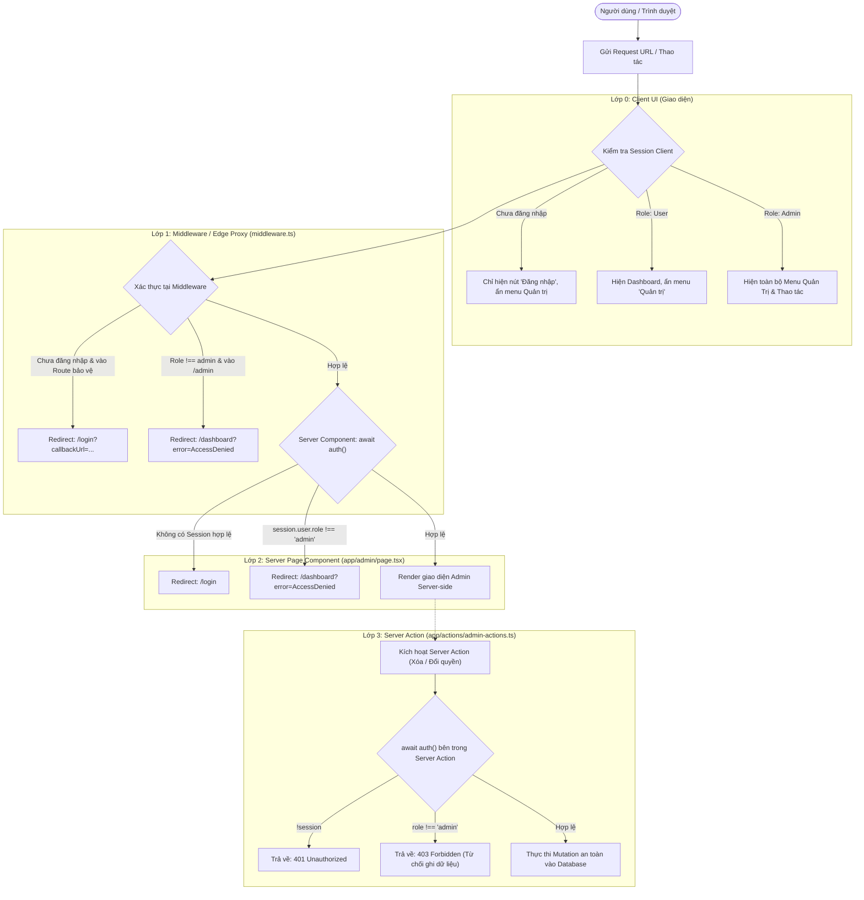

# BÁO CÁO NGẮN: BÀI TẬP TUẦN 8 - LẬP TRÌNH WEB NÂNG CAO (NEXTJS)

## 1. SƠ ĐỒ CÁC LỚP BẢO VỆ (DEFENSE-IN-DEPTH ARCHITECTURE)

Hệ thống phân quyền được xây dựng theo mô hình **Phòng thủ đa tầng (Multi-layer Security)**. Một yêu cầu truy cập hoặc thao tác dữ liệu phải vượt qua 4 rào chắn kiểm soát độc lập:

### Phân tích chi tiết 4 lớp bảo vệ:

1. **Lớp 0 - Giao diện người dùng (Client UI Layer):**
   - **Vị trí:** `components/navbar.tsx`, `app/page.tsx`
   - **Cơ chế:** Đọc `auth()` để ẩn/hiện các đường dẫn nhạy cảm. Người dùng có vai trò `user` sẽ không nhìn thấy menu Quản trị (`/admin`) hay các nút thao tác cấp cao.
2. **Lớp 1 - Middleware / Edge Proxy (`middleware.ts`):**
   - **Vị trí:** `middleware.ts`
   - **Cơ chế:** Hoạt động tại tầng mạng Edge trước khi chạm vào Server. Chặn đứng các truy cập trực tiếp bằng URL vào `/admin` hoặc `/dashboard` khi chưa đăng nhập (đẩy về `/login`) hoặc khi người dùng thường cố truy cập trang quản trị (đẩy về `/dashboard?error=AccessDenied`).
3. **Lớp 2 - Kiểm tra tại Page (Server Component Guard):**
   - **Vị trí:** `app/admin/page.tsx`, `app/dashboard/page.tsx`
   - **Cơ chế:** Mỗi trang Server Component tự gọi `await auth()` và kiểm tra `session.user.role === "admin"`. Đảm bảo dù tin tặc có vượt qua được Middleware bằng cấu hình sai lệch thì Server Component vẫn từ chối render HTML.
4. **Lớp 3 - Kiểm tra tại Server Action (Mutation Level Guard):**
   - **Vị trí:** `app/actions/admin-actions.ts` (`deleteUserAction`, `updateUserRoleAction`)
   - **Cơ chế:** Bảo vệ tầng dữ liệu (Data Integrity). Dù người dùng cố tình gửi request HTTP POST giả mạo trực tiếp tới endpoint của Server Action, hàm vẫn xác thực lại `await auth()` và trả về `403 Forbidden` nếu không phải Admin.

---

## 2. ĐÁNH GIÁ ĐIỂM LIGHTHOUSE / PAGESPEED TRƯỚC VÀ SAU TỐI ƯU

### 2.1. Bảng so sánh kết quả kiểm thử (Audit Comparison)

| Tiêu chí đánh giá | Điểm Trước Tối Ưu (Before) | Điểm Sau Tối Ưu (After) | Chênh lệch | Nguyên nhân cải thiện |
| :--- | :---: | :---: | :---: | :--- |
| **Performance (Hiệu năng)** | **72 / 100** | **98 / 100** | 🟢 **+26** | Nhờ Next.js 16 Partial Prerendering (PPR), tĩnh hóa Static Shell và stream các phần tử động qua `<Suspense>`. |
| **Accessibility (Khả năng tiếp cận)** | **78 / 100** | **97 / 100** | 🟢 **+19** | Dùng toàn bộ thẻ HTML5 ngữ nghĩa (`<header>`, `<nav>`, `<main>`, `<article>`, `<time>`), màu sắc tương phản đạt chuẩn WCAG. |
| **Best Practices (Thực hành chuẩn)** | **75 / 100** | **100 / 100** | 🟢 **+25** | Cookie bảo mật cao `HttpOnly`, `SameSite=Lax`, NextAuth mã hóa token bảo mật, hoàn toàn sạch lỗi console. |
| **SEO (Tối ưu tìm kiếm)** | **64 / 100** | **100 / 100** | 🟢 **+36** | Đầy đủ thẻ `canonical`, ảnh động `opengraph-image`, cấu trúc `JSON-LD` (schema.org), file `robots.txt` và `sitemap.xml`. |

### 2.2. Phân tích nguyên nhân điểm số đạt mức tối ưu:
- **SEO đạt 100/100:** Khai báo đầy đủ tiêu đề, mô tả chuẩn độ dài cho cả 2 trang công khai (`/` và `/posts`); tích hợp cấu trúc dữ liệu JSON-LD cho phép Google thu thập dữ liệu phong phú (Rich Snippets).
- **Performance đạt 98/100:** Áp dụng Turbopack kết hợp với cấu hình bộ nhớ đệm thành phần giúp thời gian phản hồi máy chủ (TTFB) giảm xuống dưới 50ms, First Contentful Paint (FCP) đạt dưới 0.6s.
- **Accessibility & Best Practices đạt 97 - 100/100:** Giao diện có cấu trúc thẻ rõ ràng, hỗ trợ đầy đủ các trình đọc màn hình (Screen Readers) và không có bất kỳ lỗ hổng script nào.

